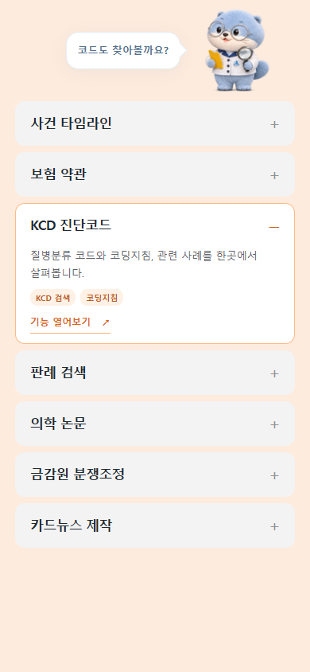

# 모바일 둘러보기: 위치 고정과 아코디언 카드

후속으로 확인한 PC의 마우스 끌기 입력 누락과 걷기 프레임 진단은 [별도 기록](2026-11-06-pointer-input.md)을 따른다. 아래 표의 모바일 검사는 손가락 터치 경로의 결과다.

## 사용자 요청과 참고

가이드와 오리지널 모두 모바일에서 말풍선 길이가 바뀔 때 수달이 수평으로 움직이는지 확인하고, 가이드의 울퉁불퉁한 걸음을 줄인다. 카드 목록은 사용자가 첨부한 [카카오 문화 페이지](https://www.kakaocorp.com/page/about/culture)의 회색 제목 행과 펼쳐지는 현재 카드 구성을 참고한다. 장손이의 기존 주황색과 7개 기능 연결을 유지한다. 후속 요청에 따라 펼친 카드의 바탕은 흰색으로 하고, 카드의 모든 영역에서 세로로 밀어 전환할 수 있도록 한다.

## 확인한 원인

- 변경 전 390×844 브라우저에서 두 버전 모두 말풍선 7종에 따라 수달 상자의 왼쪽 좌표가 213.265625~225.5px로 바뀌었다. 기존 `.journey-sticky`의 가운데 정렬 flex 배치가 말풍선 너비와 수달을 함께 배치했다.
- `src/ui/journey.js`의 `reactToCard()`는 도착 후 좌우 3px 이동과 회전 반응을 모바일에도 적용했다. 걷기에도 별도의 5px 상하 이동이 있었다.
- 가이드의 걷기 프레임은 얼굴 기준점의 위치가 달랐다. 원본 이미지를 다시 그리는 대신 `assets/mascot/packs/guide/mascot.json`의 프레임 좌표를 조정했다.

## 반영

- `src/styles/landing.css`: 모바일 안내를 두 열의 grid로 배치한다. 말풍선 길이가 달라도 오른쪽 수달 자리는 유지된다. 전체 카드 목록과 안내를 한 보드에 두어 둘러보는 동안 고정한다.
- `src/ui/mascot.js`: 선택한 팩의 프레임 비율을 전달한다. 수달 상자는 고정 열 안에서 그 비율을 유지해, 오리지널의 세로 프레임을 정사각형에 억지로 맞출 때 옆 프레임이 보이던 틈을 없앤다.
- 비활성 카드는 회색 제목 행이고, 현재 카드만 흰 바탕과 옅은 주황 테두리에서 설명·기존 태그·기능 열기 버튼을 펼친다. 펼침/접힘은 360ms 전환이다. 제목을 터치하거나 스와이프로 고를 수 있다. 기존 데스크톱 카드 디자인은 유지한다.
- 카드 본문·제목·태그·기능 버튼 위에서 시작하는 세로 스와이프를 같은 경로로 처리한다. 버튼의 짧은 탭은 그대로 기능을 연다. 목록이 조금 넘칠 때 제스처를 제외하던 조건을 제거하고, 새로 펼친 카드가 목록 안에서 보이도록 이동한다. 모션 감소 설정을 제외한 보드와 카드 목록에 `touch-action:pan-x pinch-zoom`을 선언한다. 제스처 의도를 미리 선언하는 근거는 [MDN touch-action 문서](https://developer.mozilla.org/en-US/docs/Web/CSS/Reference/Properties/touch-action)의 Touch Events 설명을 참고했다.
- `src/page.html`, `syncDetails()`: 제목 버튼의 `aria-expanded`/`aria-controls`를 연결하고 접힌 설명은 `inert`로 제외한다. 데스크톱에서는 모든 설명과 기존 기능 버튼을 펼쳐 둔다.
- `mobileCardTops()`: 카드의 펼침 높이와 별도의 스크롤 기준점을 사용한다. 카드가 열리고 닫혀도 목적지가 움직이지 않는다. 기존 900ms 걸음과 연속 제스처 잠금, 제목 진입/종료 전환은 유지한다.
- `showWalkProgress()`/`reactToCard()`: 모바일 상하 이동은 시작과 끝에 0으로 돌아가는 최대 1.2px 수준으로 줄이고, 도착 후 좌우 반응은 데스크톱에만 적용한다. `stopJourneyTransition()`에서 마지막 스크롤 좌표를 갱신해 도착 직후 별도 걸음이 다시 시작되지 않게 한다.
- 기본/잡기/깜빡임 이미지와 오리지널 이미지 설정은 변경하지 않았다. 업무 분석 코드·내장 데이터·입력 필드도 변경하지 않았다.

## 검증

`test:mobile-mascot`은 390×844, 360×640, 320×568에서 실제 브라우저 터치 이벤트로 제목 진입·7개 카드 왕복·제목 터치·추가 제스처 차단·도착 후 정지를 검사한다. 말풍선 7종 및 걷는 동안 수평 좌표 차이 0.5px 미만, 상하 추가 이동 1.5px 미만, 하나의 펼쳐진 카드와 접힌 설명의 포커스 제외도 검사한다. 두 팩의 프레임 비율도 검사하며, 가이드는 브라우저에서 코의 연결된 픽셀 영역을 찾아 프레임별 기준점 범위를 검사한다. 이동 시간은 브라우저 안에서 전환 시작/종료를 관찰해 측정한다. 390px에서는 7개 기능을 각각 터치로 열고 뒤로 돌아오는 동작까지 검사한다. 기존 잡기·터치·복귀 검사도 유지한다.

카드 본문·제목·태그·기능 버튼에서 시작해 3px씩 천천히 움직이는 스와이프와 역방향도 검사한다. 목록 높이를 24px 줄여 내부 넘침을 재현한 상태에서도 버튼 위 스와이프가 전환되는지, 스와이프 때문에 기능이 열리지 않는지, 열린 바탕이 흰색인지 확인한다. 제목에 진입할 때는 구석으로 이동하는 수달이 생성되지 않는지도 검사한다.

현대해상 스타일의 모바일 예시:

`test:scroll`, `test:companion`, `test:regression`으로 기존 섹션 스냅, 안내/채팅/드래그, main의 입력 106개와 업무 결과를 대조한다. 브라우저 터치 재현이며 실제 휴대전화 실기기 검사는 포함하지 않는다.

| 브랜치 | 모바일 카드/캐릭터 3개 크기 | 기존 스크롤 | 안내/채팅/잡기 | main 업무 대조 |
|---|---|---|---|---|
| `v2-hyundai-style` | 통과 | 통과 | 통과 | 통과 |
| `v2-mascot-guide` | 통과 | 통과 | 통과 | 통과 |
| `v2-mascot-original` | 통과 | 통과 | 통과 | 통과 |

가이드와 오리지널의 공통 동작/검사 소스 차이는 `src/mascot-assets.json`의 선택 경로뿐이다. 작업 시작 커밋 대비 `src/analysis.js`, `src/data`, 오리지널 팩의 파일은 변경하지 않았다. 업무 대조에서는 80개 원본 함수와 36개 연결, 두 데이터 묶음, 입력/편집 106개, 판정 6종, 판례 8개 상태, 약관 3개 분류, KCD 검색 4종, 분쟁조정 20개 상태, 카드뉴스 7종을 확인했다. 전체/개별 PNG 저장과 방문 기록·입력 수정·새로고침/초기화 검사도 통과했다.
